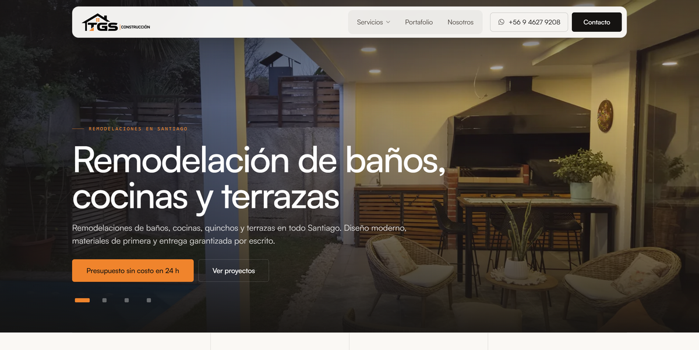
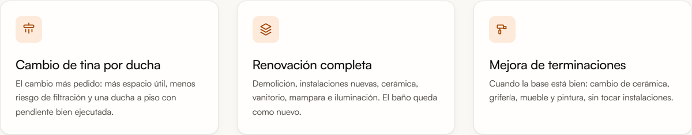
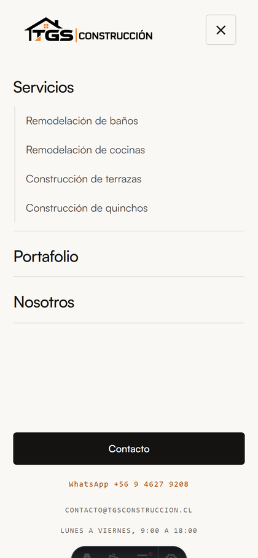

# TGS Construcción — Sitio web en Astro

Sitio estático de **TGS Construcción**, empresa de remodelación, construcción e instalación en Santiago de Chile. Reemplaza la versión en WordPress + Bricks por un sitio Astro que se compila en menos de 2 segundos, no necesita base de datos y se edita por código o desde un panel visual.



## Stack

- **Astro 5** — generación estática, sin JavaScript por defecto
- **CSS propio** con variables — sin frameworks
- Satoshi en local (`.woff2`) e Instrument Serif
- Blog en Markdown con colecciones tipadas
- Sitemap automático (`@astrojs/sitemap`)

## Comandos

```bash
npm install       # dependencias
npm run dev       # servidor local
npm run build     # genera dist/ (21 páginas)
npm run preview   # sirve dist/ compilado
```

## Estructura

```
src/
├─ components/      Header · Footer · PageHero · ServiceLanding
├─ data/            site.json (contacto, nav, textos) · iconos.ts
├─ content/posts/   12 artículos en Markdown
├─ layouts/         Base.astro (head, fuentes, metadatos)
├─ pages/           21 rutas
└─ styles/          global.css (sistema visual completo)
public/
├─ fonts/           Satoshi 300/400/500/700
├─ img/             fotografías, videos y pósteres
├─ _redirects       301 de WordPress → Astro
└─ _headers         caché y cabeceras de seguridad
```

## Páginas

| Ruta | Contenido |
| --- | --- |
| `/` | Portada con hero tipo slider |
| `/remodelacion-de-banos/` | Introducción con video · tipos · obras · proceso · FAQ |
| `/remodelacion-cocinas/` | Ídem |
| `/construccion-de-terrazas/` | Ídem |
| `/construccion-quinchos/` | Ídem |
| `/portafolio/` | Obras entregadas en video y foto |
| `/blog/` | Índice de artículos |
| `/blog/<slug>/` | 12 artículos |
| `/nosotros/` · `/contacto/` | Institucional y contacto |

## Decisiones de diseño

- **Paleta de marca**: naranja `#F0842C` y negro, tomados del logo oficial. Dos tokens para el acento: `#F0842C` en superficies y `#A64D0D` en texto sobre fondo claro, porque el naranja puro no alcanza contraste AA como texto.
- **Tres roles de radio y ninguno más**: 16 px contenedores, 10 px elementos medios, 5 px controles.
- **Nav de dos estados**: transparente sobre el hero, glass al hacer scroll.
- **Colores planos**, sin degradados decorativos; solo velos sobre fotografía para asegurar legibilidad.
- **Iconos en lugar de números** en las tarjetas de servicio y de beneficios.

## Accesibilidad y calidad

Medido con navegador real en las 21 páginas a tres anchos (1512, 980 y 390 px):

- Contraste **AA en todo el sitio**, incluido el texto sobre fotografía, medido sobre los píxeles reales de cada imagen
- Objetivos táctiles de 44 px o más
- Un solo `H1` por página y sin saltos en el orden de encabezados
- Todas las imágenes con `alt`, ningún enlace sin nombre accesible
- Cero desborde horizontal en móvil





## Rendimiento

- 21 páginas compiladas en ~1,6 s
- Imágenes y videos locales: sin dependencias del hosting anterior
- Videos con `preload="none"` y póster: no descargan hasta que el usuario interactúa

## Editar contenido sin tocar código

El archivo `.pages.yml` define un panel visual. Conectando el repositorio en https://app.pagescms.org se edita desde el navegador:

- **Artículos del blog** → `src/content/posts/*.md`
- **Textos del sitio** → `src/data/site.json` (portada, servicios, testimonios, FAQ, teléfono, comunas)

Cada cambio queda como commit y el sitio se reconstruye solo.

## Deploy

Cloudflare Pages: build `npm run build`, salida `dist`, Node 20 o superior.
Primero en `*.pages.dev` para revisar y después se apunta el dominio cuando el cliente apruebe.
